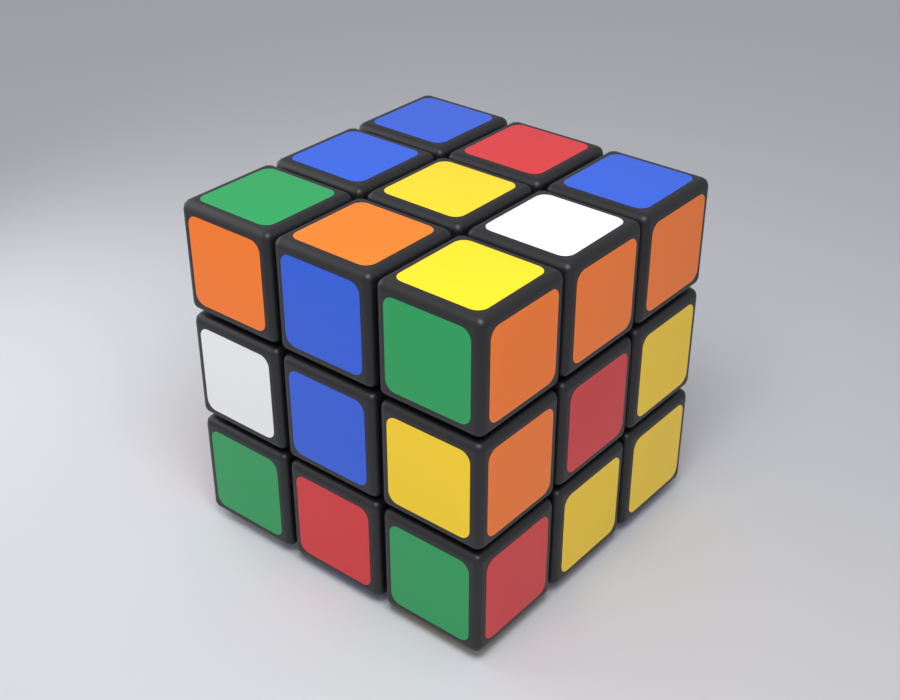

# 3D Cube

An interactive 3×3 puzzle cube built with three.js (r128, loaded from cdnjs).

Open `index.html` in a browser.

- Drag a sticker to turn its layer; drag the empty space to rotate the view.
- Keys: U D L R F B M E S turn a layer, Shift for counter-clockwise, Ctrl+Z to undo.
- Random shuffle with an intensity slider (1 to 30 turns, Easy to Expert), Solve (plays back the inverse of every move made), Undo, Reset.
- Move counter and a timer that starts on your first move after a scramble and stops when the cube is solved.

## Blender version

`blender/twisty_cube.py` is a Blender add-on (Blender 3.6 or newer, tested with 4.2) with the same puzzle, rendered as a realistic model.

**Run it**
1. Open Blender, go to the **Scripting** tab, open `blender/twisty_cube.py` and click **Run Script**. It builds the cube, camera, lights and floor.
   To keep it permanently: **Edit → Preferences → Add-ons → Install…**, pick the file and enable "Twisty Cube 3x3".
2. In the 3D Viewport press **N** and open the **Twisty Cube** tab.
3. Click **Play (drag stickers)**.

**While playing**
- Left-drag a sticker to turn its layer; left-drag empty space (or middle-drag) to look around; scroll to zoom.
- U D L R F B M E S turn a layer, Shift for counter-clockwise, Ctrl+Z undoes a turn, Esc stops playing.
- The sidebar has the face-turn buttons, Scramble, Solve, Undo, Reset, the move count, a timer and the solved status.

Blender is Z-up, so Up is +Z, Front is −Y and Right is +X. Press F12 to render the cube as it is.
